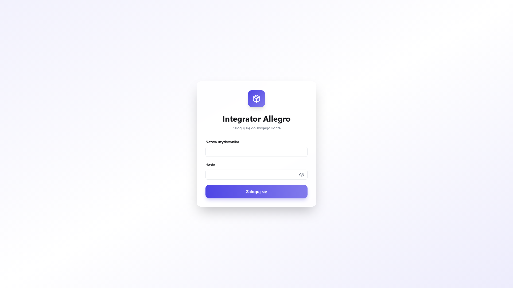
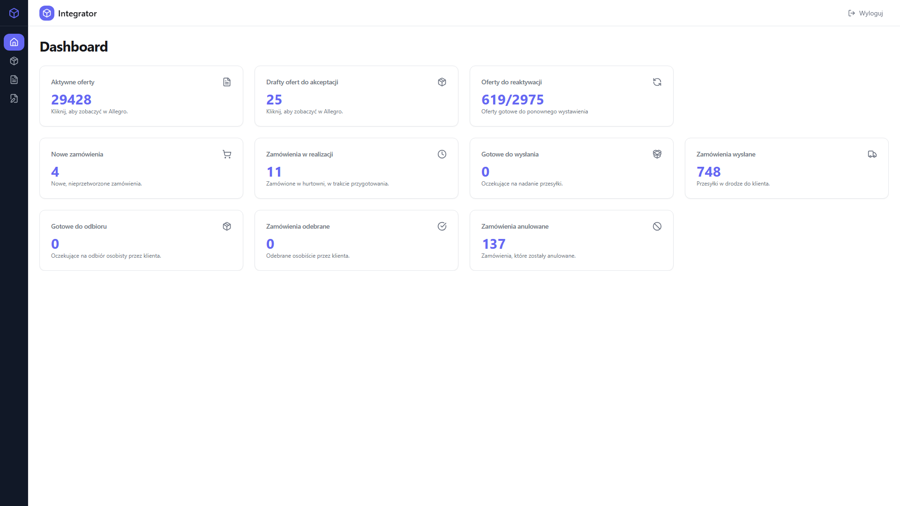
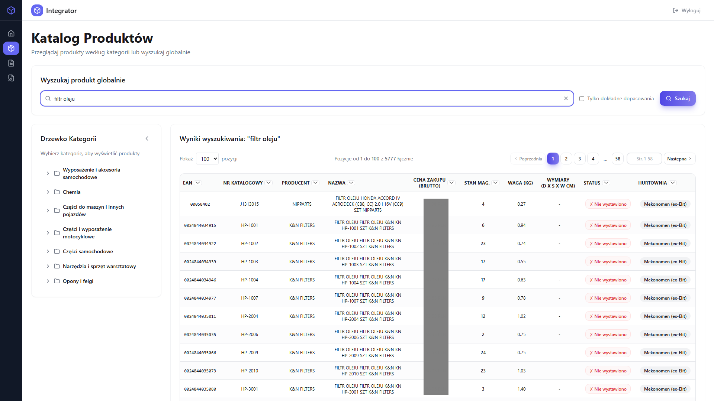
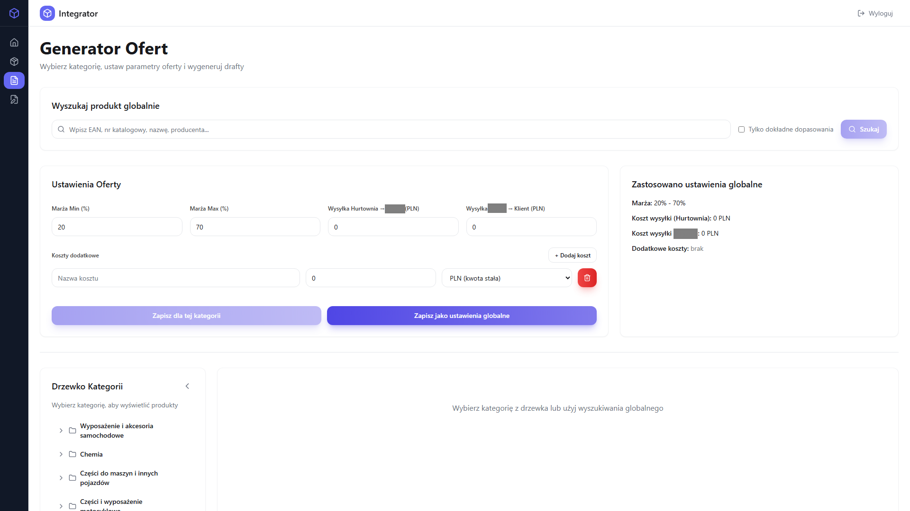
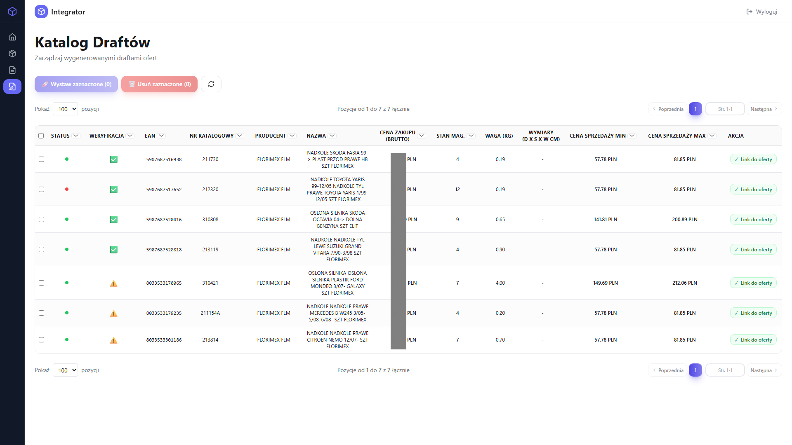
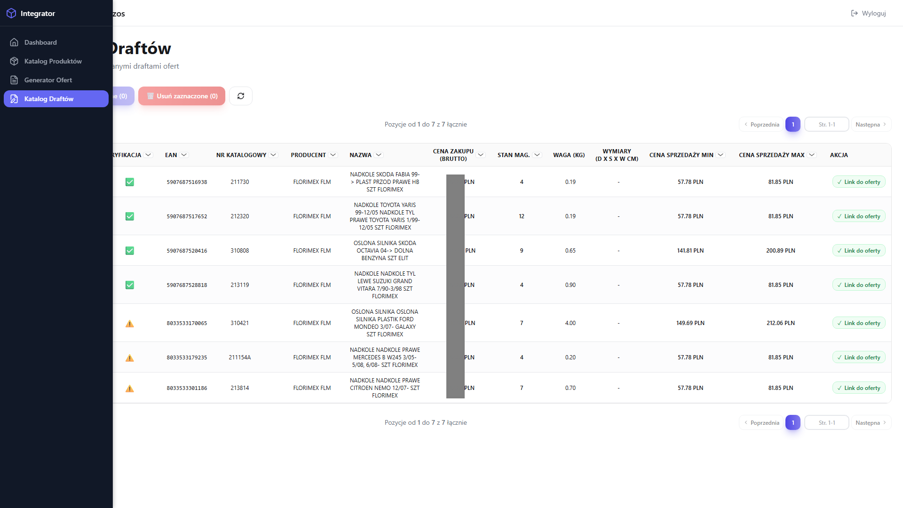
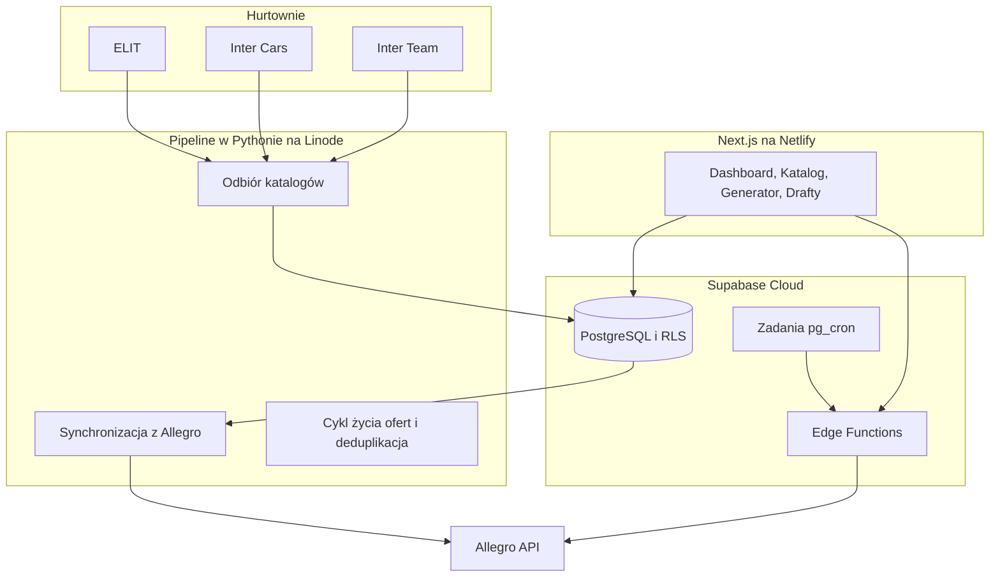

<p align="center"><a href="README.md"><strong>Polski</strong></a> | <a href="README.en.md">English</a></p>

<p align="center">
  
</p>

<h1 align="center">Int3gro.pl</h1>

<h3 align="center">Integrator Allegro</h3>

<p align="center">
  <em>Int3gro.pl łączy katalogi hurtowni części samochodowych z Allegro: importuje dane, scala duplikaty, wystawia oferty i przekazuje zamówienia do właściwego dostawcy.</em>
</p>

<p align="center">
  
  
  
  
  
  
</p>

---

## Spis treści

- [O projekcie](#o-projekcie)
- [Zrzuty ekranu](#zrzuty-ekranu)
- [Kod źródłowy](#kod-źródłowy)
- [Stack](#stack)
- [Funkcje](#funkcje)
- [Architektura](#architektura)
- [Statystyki](#statystyki)
- [Moja rola](#moja-rola)
- [Kontakt](#kontakt)

---

## O projekcie

**Int3gro.pl** to platforma integracyjna na produkcji. Synchronizuje katalogi hurtowni części samochodowych z **Allegro**, największym marketplace w Polsce.

Pobiera dane z hurtowni ELIT, Inter Cars, Inter Team, Florimex i Mekonomen, scala produkty i usuwa duplikaty, wystawia oferty na Allegro i nimi zarządza, a zamówienia klientów przekazuje do właściwego dostawcy.

Panel działa na [int3gro.pl](https://int3gro.pl), na Netlify. Pipeline w Pythonie na Linode co noc importuje katalogi, synchronizuje stany magazynowe i automatyzuje cykl życia ofert. Supabase obsługuje bazę danych, Edge Functions, RLS i zaplanowane zadania.

---

## Zrzuty ekranu

| Logowanie | Dashboard |
|:---:|:---:|
|  |  |

| Katalog produktów | Generator ofert |
|:---:|:---:|
|  |  |

| Drafty | Nawigacja |
|:---:|:---:|
|  |  |

> **Uwaga:** Wszystkie dane na zrzutach są fikcyjne i powstały wyłącznie na potrzeby demonstracji. Nazwy produktów, ceny, stany magazynowe i szczegóły zamówień są wymyślone i nie odzwierciedlają rekordów żadnego dostawcy ani marketplace.

---

## Kod źródłowy

> **Kod źródłowy jest prywatny.**

---

## Stack

### Panel

```
Next.js 16 + React 19      // App Router, logowanie po stronie serwera, dev na Turbopacku
TypeScript 5               // typy w całym projekcie
Tailwind CSS 3.4           // klasy przy elementach i Framer Motion
TanStack Table 8           // tabele produktów i zamówień, dane brane z serwera
```

### Baza i funkcje

```
Supabase PostgreSQL        // wspólny widok produktów, uprawnienia wierszy (RLS), pg_cron
19 Edge Functions          // API Allegro, składanie zamówień, cykl życia ofert
pg_trgm                    // szybkie szukanie pełnym tekstem po katalogach
Netlify                    // panel int3gro.pl na produkcji
```

### Pipeline

```
Python 3 na Linode         // co noc odbiór FTP od hurtowni i synchronizacja z Allegro
23 skrypty                 // deduplikacja, nieaktualne oferty, zakresy cen, stany magazynowe
Allegro REST API           // oferty, zamówienia, kategorie, realizacja
API hurtowni               // ELIT po SOAP, Inter Cars po OAuth, Inter Team po mTLS
```

---

## Funkcje

### Dashboard

- **Karty KPI** - Na pulpicie widać aktywne oferty, szkice, zamówienia i kolejkę wznawiania.
- **Tabele zamówień** - W tabeli są zamówienia z Allegro wraz ze statusem routingu do dostawcy.
- **Nocne skrypty** - Widać status skryptów z nocnych przebiegów.
- **Wznawianie ofert** - Zakończone oferty, które mają stan, wracają na Allegro hurtem.

### Katalog produktów

- **Drzewo kategorii** - Kategorie Allegro są ułożone w drzewo. Przy każdej widać, ile jest w niej produktów.
- **Szukanie** - Szukanie idzie trigramami (pg_trgm) po scalonych katalogach hurtowni.
- **Strony katalogu** - Tabela mieści tysiące produktów, ze stanem i z informacją, czy oferta jest wystawiona. Długi wynik jest pocięty na strony.

### Generator ofert

- **Wystawianie z kategorii** - Wybiera się produkty z kategorii i ustawia marżę osobno dla każdej.
- **Kalkulator ceny** - Liczy minimalną i maksymalną cenę sprzedaży oraz zasady prowizji.
- **Wystawianie hurtem** - Na Allegro idzie naraz wiele ofert. Wystawienie przechodzi przez Edge Functions.

### Szkice

- **Podgląd przed publikacją** - Są tu produkty gotowe do publikacji, z podglądem ceny.
- **Cena z Allegro** - Panel pyta Allegro o cenę, zanim oferta zostanie wystawiona. Odpowiedź przychodzi od razu.

### Nocny pipeline

- **Odbiór katalogów** - Co noc przychodzą katalogi ELIT, Inter Cars i Inter Team. Źródłem jest FTP tych hurtowni.
- **Deduplikacja** - Produkty z trzech źródeł schodzą się po EAN do jednego widoku.
- **Koniec i powrót oferty** - Oferta ze stanem zero kończy się sama. Gdy stan magazynowy wraca, oferta wraca na Allegro.
- **Zamówienie do hurtowni** - Zamówienie z Allegro system składa w ELIT, Inter Cars albo Inter Team. Wołanie idzie przez Edge Functions.

### Bezpieczeństwo

- **Wejście do panelu** - Sesja leży w ciasteczku. Middleware nie otwiera zamkniętych stron bez tej sesji.
- **Tylko administrator** - Do tabel katalogu i ustawień dostęp ma tylko administrator (RLS).
- **Nocne wywołania** - Zaplanowane Edge Functions są uwierzytelniane tajnym nagłówkiem.

---

## Architektura



---

## Statystyki

### Liczby

| Element | Liczba |
|---|---|
| **Ścieżki panelu** | 5 |
| **Komponenty React** | ~30+ |
| **Edge Functions w Supabase** | 19 |
| **Migracje SQL** | 46 |
| **Skrypty Pythona** | 23 |
| **Integracje z hurtowniami** | 5 |

### Skrót

| Obszar | Co tam jest |
|---|---|
| **Katalog** | Scalenie wielu hurtowni, szukanie trigramami, drzewo kategorii |
| **Oferty** | Wystawianie hurtem, szkice, kalkulator ceny, wznawianie |
| **Zamówienia** | Pobranie z Allegro, przekazanie do dostawcy, statusy |
| **Pipeline** | Import co noc, deduplikacja, stany, sprzątanie nieaktualnych ofert |
| **Bezpieczeństwo** | RLS, logowanie po stronie serwera, tajny nagłówek, dostęp tylko dla administratora |

---

## Moja rola

Zbudowałem Int3gro.pl, platformę do synchronizacji katalogów hurtowni części samochodowych z Allegro.

---

## Kontakt

| Gdzie | Adres |
|---|---|
| **Email** | [wandrysiak.it@gmail.com](mailto:wandrysiak.it@gmail.com) |
| **GitHub** | [wandrysiak](https://github.com/wandrysiak) |

---

**Int3gro.pl** łączy hurtowe katalogi części samochodowych z Allegro w dużej skali.

<p align="center"><em>Zrobili to Wojciech Andrysiak i Kamil Kaczmarek.</em></p>
